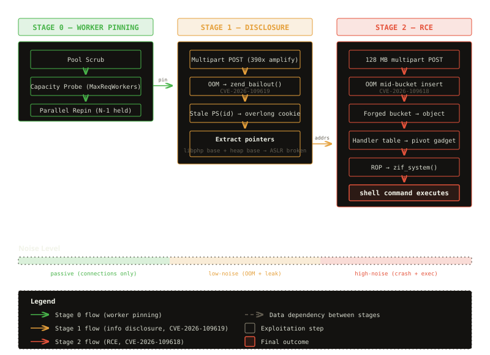
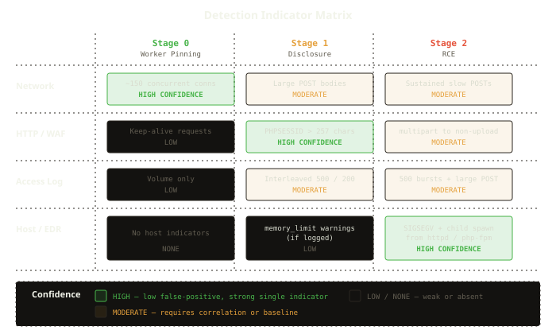

## 概要

PHP 5.4 以降すべてのバージョンに影響する 2 件の critical use-after-free 脆弱性 CVE-2026-109618 / CVE-2026-109619 を技術的に分析する。session.upload_progress ハンドラがアプリケーションコードの実行前に動作する設計を起点に、Apache mod_php 環境で認証なしにリモートコード実行に至る攻略チェーンの構造を解説する。OOM bailout の不完全なクリーンアップがなぜ use-after-free を生むのか、情報リークと RCE をどう繋ぐのか、そして防御側が着目すべき検知指標と緩和策を整理する。

## Introduction

PHP powers more than three-quarters of the web's server-side code. When a critical vulnerability surfaces in the core runtime — not in a framework, not in a plugin, but in the engine itself — the blast radius is enormous. On October 21, 2026, the PHP security team disclosed two use-after-free vulnerabilities in PHP's session handling and OOM (Out-of-Memory) recovery that affect every PHP installation since version 5.4, released in 2012.

CVE-2026-109618 and CVE-2026-109619, collectively known as PHP2Shell, each carry a CVSS v4.0 score of 9.2. They chain together to produce unauthenticated remote code execution on Apache mod_php — and the attack fires before application code runs, rendering all application-level defenses irrelevant. By October 26, both CVEs had been added to CISA's Known Exploited Vulnerabilities (KEV) catalog, with federal agencies given just three days to remediate under BOD 26-04.

The scale of exposure is substantial. Based on Shodan scans, roughly 2.23 million hosts advertise PHP via the `X-Powered-By` header, and approximately 884,000 of those run versions that will receive no upstream fix. Japan alone accounts for over 55,000 of those unpatched hosts.

This article dissects the root causes of both vulnerabilities, explains how they combine into a multi-stage exploitation chain, and identifies the detection and mitigation opportunities that defenders can act on. The focus is on understanding why these vulnerabilities exist and why the exploit works the way it does — the architectural decisions and implementation patterns that created this attack surface.

## PHP's Session Lifecycle: Where Per-Request State Lives and Dies

To understand PHP2Shell, you need to understand how PHP manages state within a web request — and critically, what happens when that management is interrupted.

In an Apache mod_php deployment using the prefork Multi-Processing Module (MPM), each HTTP request is handled by a dedicated worker process. The process persists across multiple requests, but PHP is designed to isolate request state: global variables, session data, and internal structures are initialized at the start of each request and cleaned up at the end. The PHP documentation refers to this as the "shared-nothing" model, and it is PHP's primary defense against cross-request contamination.

At the heart of this model sits a collection of per-request global structures. The session subsystem maintains state through internal macros — the current session identifier, the session module's internal data, and associated serialization state. Under normal operation, these values are initialized during request startup, consumed during processing, and reset during shutdown. The cleanup sequence is deterministic: PHP walks its internal shutdown routines, releases memory, and returns the worker process to a clean state for the next request.

The `session.upload_progress` feature introduces a critical complication. Enabled by default since PHP 5.4, this feature allows PHP to track the progress of file uploads by populating a `$_SESSION` entry during multipart form parsing. The key architectural detail: this processing happens during the SAPI (Server Application Programming Interface) layer's request initialization — before `session_start()` is called and before any application code runs. The upload progress handler actively reads and writes session state as part of multipart parsing, creating a window where session data structures are populated by the engine itself, outside the application's control.

In normal operation, this poses no problem. The upload progress data is written, consumed, and cleaned up within the request lifecycle. But "normal operation" assumes that the lifecycle completes — that every initialization step has a corresponding cleanup step, and that cleanup runs to completion. When it does not, the conditions for CVE-2026-109619 appear.

The shared-nothing model is only as strong as its weakest cleanup path. PHP2Shell demonstrates that when the emergency exit fires, "shared-nothing" becomes "shared-everything."

## CVE-2026-109619: When Stale State Outlives Its Request Heap

The first vulnerability targets a gap in PHP's fatal error recovery. When a request triggers a fatal error — most commonly an out-of-memory condition caused by exceeding `memory_limit` — PHP calls `zend_bailout()`, which performs a `longjmp()` to abort the current request. This is PHP's emergency exit: it abandons whatever the request was doing and jumps directly to the cleanup handler.

The problem is that `longjmp()` unwinds the call stack without executing destructors, `finally` blocks, or any other cleanup code that would run during a normal shutdown. When the OOM bailout fires during upload progress processing, internal global state — particularly the session identifier pointer — can still reference memory allocated during the dying request. The request's heap is freed, but the global pointer remains.

Under Apache prefork's persistent-worker model, the next request assigned to the same worker inherits this stale pointer. When the upload progress handler runs again — which happens automatically for any multipart POST, since `session.upload_progress` is enabled by default — it accesses the stale session identifier before normal session initialization can replace it. The stale pointer now references freed heap memory — a textbook use-after-free.

What makes this especially dangerous is the information it exposes. The `Set-Cookie` header generated from the stale session identifier can contain arbitrary data from the freed heap region — passwords, session tokens, API keys, even TLS private keys from other requests that previously occupied the same memory. Researchers have demonstrated leaks of up to 800 KB through oversized `PHPSESSID` cookies, drawing direct comparisons to Heartbleed (CVE-2014-0160). And like Heartbleed, this leak runs at the engine level, below any application-layer monitoring.

The stale-state condition extends beyond session identifiers. PHP 8.5 introduced `fatal_error_backtraces`, enabled by default, which stores backtraces from fatal errors. These backtrace structures also reference per-request memory and survive into subsequent requests through the same mechanism, providing an additional attack surface for the use-after-free.

The core insight is that `longjmp()`-based error recovery is fundamentally incompatible with deterministic cleanup. Every piece of state that outlives the jump becomes a potential dangling pointer, and PHP's internal state graph has enough long-lived global references that OOM conditions reliably leave exploitable stale pointers behind.

## CVE-2026-109618: The Incomplete HashTable Bucket

The second vulnerability targets PHP's internal hash table implementation — the data structure that underpins PHP arrays, object properties, and symbol tables.

During multipart form parsing, PHP processes uploaded fields and file metadata by inserting entries into internal hash tables. Each insertion allocates a new bucket, links it into the hash table's collision chain, and populates it with the entry's key and value. This is a multi-step operation: the bucket is allocated, then its fields are filled one by one.

When an out-of-memory condition occurs midway through this insertion — after the bucket is allocated and partially linked, but before all fields are populated — the hash table is left in an inconsistent state. The bucket exists in the collision chain with uninitialized or partially initialized fields. The Zend memory manager's `longjmp()` bailout then hands this corrupted hash table to PHP's cleanup routines.

During shutdown, the array destructor walks the hash table and calls destructors on each entry. When it reaches the incomplete bucket, it interprets the uninitialized memory as valid data. If an attacker controls what occupies that memory region — through careful heap layout manipulation — the destructor processes attacker-controlled values. The cleanup code dereferences a forged value pointer, follows it to a forged object structure, and calls the object's destructor function pointer, which can point anywhere in the process address space.

This is the critical transition from memory corruption to code execution. The forged object's handler table redirects the destructor call through a controlled function pointer, which an attacker populates with a stack pivot gadget. From there, a ROP (Return-Oriented Programming) chain takes over, chaining together existing code fragments within libphp to reach `zif_system()` — PHP's internal wrapper for C's `system()` function — and execute an arbitrary shell command.

The attack does not require writing shellcode to executable memory. It reuses code already present in libphp itself, making it effective even on systems with W^X (Write XOR Execute) memory protections. However, ASLR (Address Space Layout Randomization) randomizes the addresses of these code fragments on every process start, which is where CVE-2026-109619's information leak becomes essential.

## Chaining the Two: A Multi-Stage Exploitation Sequence

The two CVEs are individually concerning but not independently weaponizable for reliable RCE. CVE-2026-109619 provides a memory disclosure primitive but no code execution path. CVE-2026-109618 provides a code execution path but requires knowledge of memory layout that ASLR obscures. Together, they form a complete chain.

{: width="800" height="580" }

_PHP2Shell exploitation flow: three phases of increasing noise, each dependent on the previous stage's output._

### Stage 0: Worker Pinning

Before the chain can begin, the attacker must solve Apache prefork's process model. Each request is assigned to an arbitrary worker from the pool, but both the disclosure stage and the RCE stage must target the same worker — the disclosure leaks that specific worker's memory layout, and the RCE must execute within that same address space.

The approach involves saturating the worker pool. By opening enough persistent connections to occupy all available workers (typically 150 in a default Apache configuration), the attacker controls which worker handles the next request. The technique proceeds in three phases: a pool scrub that cycles all workers to a known state, a capacity probe that determines `MaxRequestWorkers`, and a parallel repin that occupies every worker except one, routing the attack through that single available slot.

This is the noisiest part of the attack. An observer monitoring connection counts will see a rapid spike to the `MaxRequestWorkers` limit, sustained for the duration of the exploitation sequence. The pool saturation pattern — 150 simultaneous persistent connections from a single source — is a strong indicator of an attack in progress.

### Stage 1: Information Disclosure via Overlong Set-Cookie

With a worker pinned, the attacker sends a crafted multipart POST designed to trigger an OOM condition. The request body exploits PHP's recursive array handling for `$_FILES`: nested empty-filename fields create approximately a 390x heap amplification ratio, inflating a modest 1 MB upload into a memory footprint that exceeds `memory_limit`.

When OOM hits, `zend_bailout()` fires and abandons the request. The stale session identifier from CVE-2026-109619 now references freed heap memory. The attacker immediately sends a second request to the same worker — possible because of the worker pinning from Stage 0 — with upload progress tracking active. The upload progress handler reads the stale identifier, interpreting freed heap contents as a session ID, and emits it in a `Set-Cookie: PHPSESSID=<heap contents>` header.

The leaked cookie is often 100 KB or more — far larger than any legitimate session identifier. From this dump, the attacker extracts pointers to libphp and the Zend heap. Pointers appear repeatedly in heap memory because PHP's internal structures are densely pointer-laden. By URL-decoding the leaked cookie, scanning for 8-byte values in the user-space pointer range, and counting frequencies, the dominant pointer reveals the libphp base address. A known delta between libphp and the Zend main heap chunk provides the heap base. ASLR is broken.

### Stage 2: 128 MB Amplified RCE

Armed with the libphp base address and heap location, the attacker constructs the final payload. A second multipart POST, larger than the first, triggers another OOM — but this time, the heap is primed with attacker-controlled data at predictable addresses. The hash table insertion path allocates a bucket that gets interrupted by the OOM bailout.

The attacker controls what sits in the freed memory region by carefully sizing the multipart body. When the array destructor walks the corrupted hash table during cleanup, it encounters the forged bucket. The cleanup code follows the forged pointers through a chain: forged value → forged object → forged handler table → stack pivot gadget → ROP chain → `zif_system()`.

The ROP chain itself is compact. A pop-rdi gadget loads the command string's address into the first argument register, a pop-rsi gadget sets the return value pointer, and then `zif_system()` executes the command. The command is embedded directly in the payload, limited to 47 usable characters by the carrier structure's fixed size.

The worker crashes after execution — the ROP chain corrupts the stack beyond recovery — so any command output that is not redirected to a file or a reverse shell is lost. The practical approach is to write a minimal web shell in a single command (which fits within the 47-character limit) and then execute unlimited commands through it.

## Why mod_php Is the Primary Target

The advisory rates Apache mod_php as the highest-risk configuration, and the exploit construction reveals why. Three architectural properties of mod_php with prefork converge to make exploitation reliable.

First, worker persistence. Prefork workers survive across requests, preserving the stale heap state that CVE-2026-109619 depends on. PHP-FPM workers can also persist, but FPM offers the `pm.max_requests` directive to limit the number of requests per worker. Setting it to 1 eliminates the cross-request stale-state vector entirely by terminating the worker after every request. Apache prefork has no equivalent built-in control.

Second, deterministic worker routing. Prefork assigns requests to workers from a finite pool using a simple accept mutex. By saturating the pool, the attacker creates a deterministic mapping between connections and workers. PHP-FPM behind a reverse proxy adds connection pooling and load balancing that make worker pinning substantially harder — the reverse proxy may distribute requests across multiple FPM pools or backend hosts, breaking the attacker's ability to guarantee same-worker affinity.

Third, pre-application execution. In mod_php, the PHP engine runs as a module inside the Apache process. Request initialization — including multipart parsing and upload progress processing — happens as part of Apache's own request handling, before any application code runs. Application-level protections — WAF middleware, authentication checks, rate limiting, CSRF token validation — are not present at the point where the vulnerability triggers. PHP-FPM still processes multipart data before application code, but the separate process boundary adds isolation that can limit certain exploitation paths, and the advisory confirms that no complete FPM exploit has been demonstrated for CVE-2026-109618 at the time of disclosure.

The combination means that a default Apache httpd installation with PHP enabled — no application deployed, no plugins installed, no configuration customized — is exploitable. The vulnerability exists in the PHP engine, not in any application it runs.

## Detection: What Defenders Can See

The exploitation chain creates observable artifacts at multiple layers, though no single indicator is definitive on its own.

{: width="700" height="420" }

_Detection surface across the three exploitation stages. Worker pinning generates strong network signals; disclosure produces anomalous cookies; RCE triggers host-level indicators._

At the network level, the worker pinning phase generates the most visible signature. A sudden spike in persistent connections — 100 to 150 simultaneous connections from a single source, sustained for seconds to minutes — is unusual for normal web traffic. Slow chunked multipart POSTs that hold connections open are another indicator, particularly when they target endpoints that do not normally receive file uploads.

At the HTTP layer, the overlong `PHPSESSID` cookie is the strongest single indicator. Legitimate PHP session identifiers are 22 to 256 characters of alphanumeric text. A `PHPSESSID` value exceeding 257 characters, particularly one containing URL-encoded binary data with percent-encoded non-printable characters, indicates either a successful memory disclosure or an exploitation attempt. WAF rules matching this pattern are high-confidence and low-false-positive.

In access logs, the attack manifests as rapid interleaved 500 and 200 status codes against a single endpoint, typically within seconds. The 500 responses correspond to the intentional OOM crashes. The 200 responses indicate the disclosure requests that capture the leaked cookies between crashes. Bursts of POST requests with anomalously large `Content-Length` values — exceeding 2 MB for endpoints that do not normally accept large uploads — add another log-based signal.

At the host level, the most reliable indicator is unexpected child process creation. When the ROP chain fires `system()`, the PHP worker forks a shell process. EDR tools and auditd rules monitoring for `sh`, `bash`, `curl`, `wget`, or other command-line utilities spawned by `httpd`, `apache2`, or `php-fpm` detect the actual payload execution — not the vulnerability trigger, but the concrete evidence of exploitation. Worker crash patterns provide supporting evidence: spikes in SIGSEGV exits (exit code 139) or core dumps from PHP workers indicate ROP chain execution, whether successful or not.

One detection gap is important to emphasize. PHP-level error configuration — `error_reporting`, `display_errors`, `log_errors` — provides zero protection against the memory disclosure or the code execution. These settings control how PHP reports errors to the application and its logs, but the use-after-free occurs below the error reporting layer. Setting `display_errors = Off` hides error messages from users but does not prevent the stale pointer from being accessed or the overlong cookie from being emitted. This is a common misconception that leads to a false sense of security.

## Mitigation: Distinguishing Fixes from Workarounds

The only complete fix is upgrading PHP to a patched version: 8.2.35, 8.3.36, 8.4.27, or 8.5.12. After upgrading the binary, all worker processes must be restarted — a package upgrade alone leaves the vulnerable binary resident in running workers. For PHP 8.1 and older, the PHP security team published source patches but no official binary releases. Distribution vendors — Ubuntu, Debian, Red Hat, CloudLinux, Remi — have backported fixes into their own package releases, sometimes retaining the original version number while incrementing the package revision.

Several interim controls reduce exposure but do not eliminate the underlying memory safety defects.

Disabling `session.upload_progress.enabled` removes the entry point for the stale-state consumer that powers the information leak. This setting must go in `php.ini` or the FPM pool configuration, not in `.htaccess` or via `ini_set()`, because runtime and per-directory settings apply too late — the upload progress handler runs during SAPI initialization, before per-request configuration takes effect. Applications that actively use upload progress tracking will lose that functionality.

Removing the OOM bailout path by setting `memory_limit` to -1 prevents the `longjmp()` that triggers the vulnerability. If PHP never hits the memory limit, it never takes the emergency exit. But this trades one risk for another: a single request can now consume all available system memory. This setting must be paired with cgroup-level memory limits (such as `MemoryMax`) to contain total process memory. Critically, do not substitute `RLIMIT_AS` or `ulimit -v` — these cause `mmap()` to return NULL, which triggers the same OOM bailout path the setting was meant to eliminate. This is a well-documented pitfall that turns a mitigation into an additional attack surface.

For PHP 8.5 specifically, disabling `fatal_error_backtraces` removes the backtrace storage that provides an additional stale-state vector for CVE-2026-109619. Earlier PHP versions do not have this feature and are unaffected by this particular entry point.

At the edge, blocking `multipart/form-data` requests on routes that do not accept file uploads eliminates the primary trigger mechanism. Every known public exploit uses multipart requests to reach the vulnerable parser. This is a high-confidence control when applicable, but it breaks legitimate upload functionality wherever it is applied.

For PHP-FPM deployments, setting `pm.max_requests` to 1 forces each worker to terminate after a single request, eliminating the persistent worker state that the cross-request use-after-free depends on. The performance cost — spawning a new worker for every request — can be significant for high-traffic sites, but the control completely blocks the multi-request exploitation chain.

The hierarchy matters. Patching is the only complete remediation. Interim controls are layered defenses that reduce the attack surface while patching is in progress. Misconfigured controls — particularly the `RLIMIT_AS` pitfall — can make things worse.

## Key Takeaways

- PHP2Shell (CVE-2026-109618 / CVE-2026-109619) affects every PHP version since 5.4 and allows unauthenticated RCE with web worker privileges. Patched versions are 8.2.35, 8.3.36, 8.4.27, and 8.5.12.
- The attack runs before application code executes, bypassing all application-level security controls including WAF middleware, authentication, and CSRF validation.
- `session.upload_progress`, enabled by default, provides the entry point by processing session state during SAPI initialization — before `session_start()` or any application code runs.
- Two bugs chain together: CVE-2026-109619 leaks heap memory through overlong `PHPSESSID` cookies to defeat ASLR, and CVE-2026-109618 corrupts a hash table bucket to hijack execution flow through a ROP chain targeting `zif_system()`.
- Apache mod_php with prefork is the highest-risk configuration because worker persistence enables cross-request state corruption, and deterministic worker routing through pool saturation makes the attack reliable.
- The overlong `PHPSESSID` cookie — exceeding 257 characters with URL-encoded binary data — is the strongest single network indicator of an exploitation attempt.
- `RLIMIT_AS` and `ulimit -v` are counterproductive mitigations. They cause `mmap()` failures that trigger the same OOM bailout path the attacker exploits. Cgroup memory limits (`MemoryMax`) are the correct containment mechanism.
- PHP-level error settings (`display_errors`, `error_reporting`) provide zero protection because the use-after-free fires below the error reporting layer.
- For PHP-FPM, setting `pm.max_requests = 1` eliminates the persistent-worker state that the cross-request chain requires, at the cost of per-request worker spawning overhead.
- Patching is the only complete fix. Interim controls reduce the attack surface but leave the underlying memory safety defects in place. The hierarchy is: patch first, layer interim controls while patching is in progress, and verify that no "mitigation" inadvertently widens the attack surface.

## References

- Rapid7 — CVE-2026-109618 and CVE-2026-109619: Critical Unauthenticated Remote Code Execution in PHP: <https://www.rapid7.com/blog/post/etr-cve-2026-109618-and-cve-2026-109619-critical-unauthenticated-remote-code-execution-in-php/>
- Sansec — PHP2Shell: PHP RCE (CVE-2026-109618, CVE-2026-109619): <https://sansec.io/research/php2shell>
- Google Cloud — Responding to core PHP vulnerabilities CVE-2026-109618 and CVE-2026-109619: <https://cloud.google.com/blog/products/identity-security/responding-to-core-php-vulnerabilities-cve-2026-109618-cve-2026-109619>
- WWT — PHP2Shell: Exploitation Before Disclosure a Technical Reference: <https://www.wwt.com/blog/php2shell-exploitation-before-disclosure-a-technical-reference>
- Phoenix Security — PHP Core RCE (CVE-2026-109618, CVE-2026-109619): Critical Remote Code Execution Flaws: <https://phoenix.security/php-core-rce-cve-2026-109618-109619-critical-remote-code-execution/>
- Exploit-DB — PHP2Shell (CVE-2026-109618) RCE (EDB-52704): <https://www.exploit-db.com/exploits/52704>
- MITRE ATT&CK — T1190 Exploit Public-Facing Application: <https://attack.mitre.org/techniques/T1190/>
- PHP — Security Advisory GHSA-w8hw-w9fx-j79w: <https://github.com/php/php-src/security/advisories/GHSA-w8hw-w9fx-j79w>
- PHP — Security Advisory GHSA-6wmf-4rv5-p3rp: <https://github.com/php/php-src/security/advisories/GHSA-6wmf-4rv5-p3rp>
- d0me refs — PHP2Shell Walk-through: <https://d0me-d0me.github.io/refs/sheets/php2shell.html>

---

> 我以外皆我師 — everyone I meet has something to teach me.
